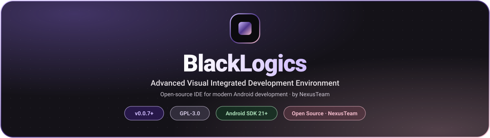
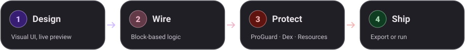
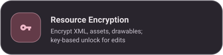
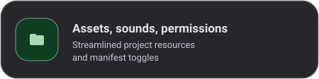
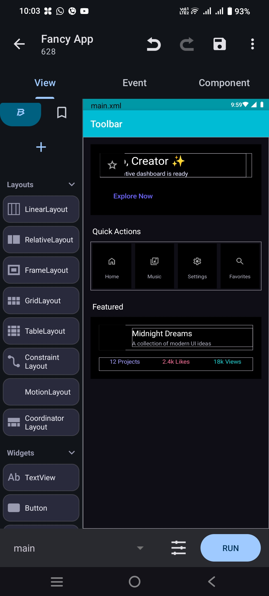
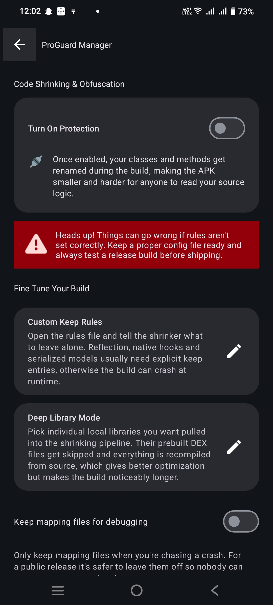
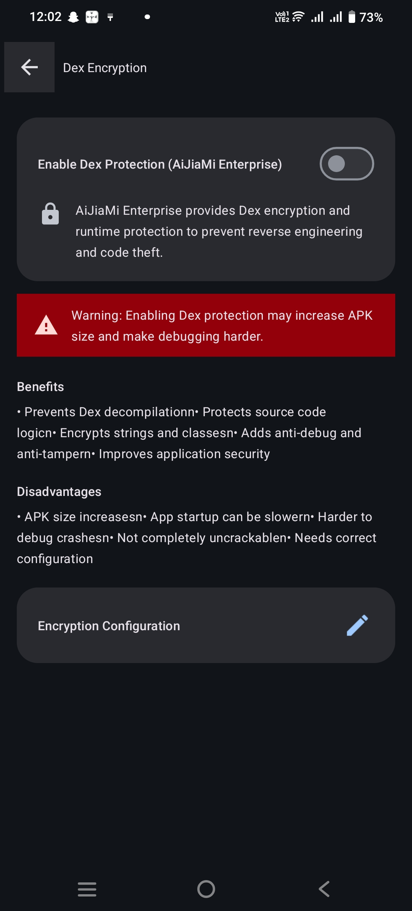
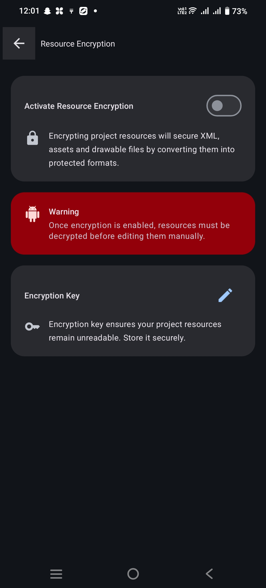
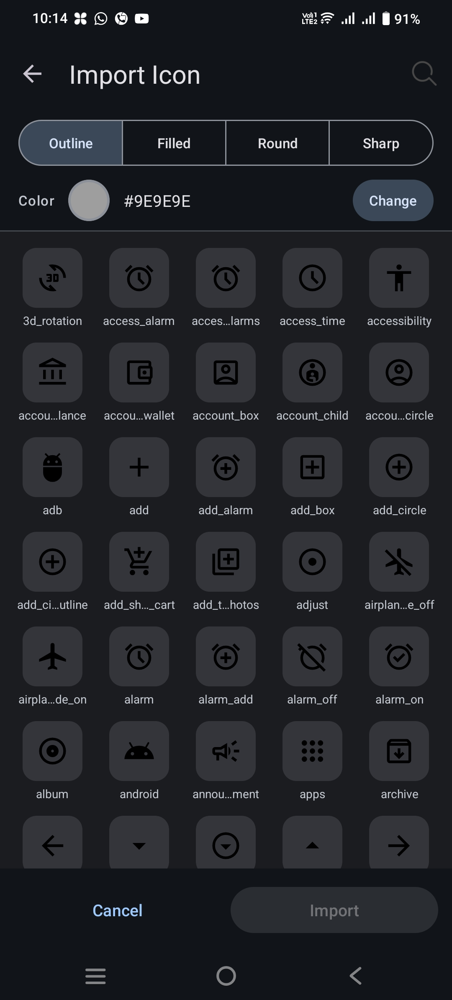
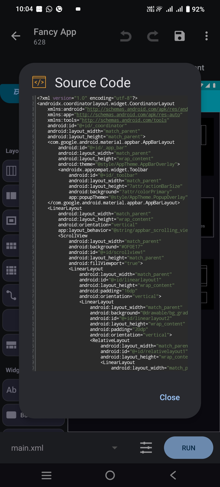

<!-- ═══════════════════════════════════════════════════════════════════════ -->
<!--                        BLACKLOGICS — README.md                          -->
<!-- ═══════════════════════════════════════════════════════════════════════ -->

<div align="center">



<br/>

<h1>BlackLogics</h1>
<h3>The Next-Generation Android IDE — Design · Wire · Protect · Ship</h3>

<p><b>Independent architecture by NexusTeam × Smart India Gaming</b></p>

<br/>

<!-- ═══ Quick Access Buttons ═══ -->
<a href="#-installation">
  
</a>
&nbsp;
<a href="#-key-features">
  
</a>
&nbsp;
<a href="#-interface-preview">
  
</a>
&nbsp;
<a href="#-contributing">
  
</a>

<br/><br/>

<!-- ═══ Status & Metric Badges ═══ -->
<p>
  <a href="LICENSE"></a>
  <a href="#-installation"></a>
  <a href="#-key-features"></a>
  <a href="#-installation"></a>
  <a href="CHANGELOG.md"></a>
</p>

<p>
  <a href="https://github.com/NexusTeamOfficial/BlackLogics-Open-Source/stargazers"></a>
  <a href="https://github.com/NexusTeamOfficial/BlackLogics-Open-Source/network/members"></a>
  <a href="https://github.com/NexusTeamOfficial/BlackLogics-Open-Source/issues"></a>
  <a href="https://github.com/NexusTeamOfficial/BlackLogics-Open-Source/pulls"></a>
  <a href="CONTRIBUTING.md"></a>
  <a href="https://t.me/blacklogics"></a>
</p>

<br/>

> **⚡ Drag-and-drop simplicity, met with full Android SDK power.**
> Design UI visually → wire logic with blocks → lock releases with ProGuard / AiJiaMi Dex encryption / resource encryption → **export or run.**

</div>

---

<!-- ═══════════════════════════════════════════════════════════════════════ -->
<!--                          TABLE OF CONTENTS                              -->
<!-- ═══════════════════════════════════════════════════════════════════════ -->

## 📑 Table of Contents

- [📖 Overview](#-overview)
- [✨ Key Features](#-key-features)
  - [🧩 Core IDE](#-core-ide)
  - [🛡️ Security Suite](#️-security-suite)
- [🖼️ Interface Preview](#️-interface-preview)
- [🚀 Installation](#-installation)
- [📱 Quick Start](#-quick-start)
- [🛠️ Tech Stack](#️-tech-stack)
- [🤝 Contributing](#-contributing)
- [🗺️ Roadmap](#️-roadmap)
- [❓ FAQ](#-faq)
- [👥 Team](#-team)
- [📜 License](#-license)
- [🌐 Connect](#-connect-with-us)

---

<!-- ═══════════════════════════════════════════════════════════════════════ -->
<!--                             OVERVIEW                                    -->
<!-- ═══════════════════════════════════════════════════════════════════════ -->


## 📖 Overview

**BlackLogics** is an **independent, ground-up IDE architecture** by **NexusTeam (Smart India Gaming)** — it is **not a fork** of Sketchware or any other project. It bridges **visual drag-and-drop development** with the **full Android SDK** so you can build real, shippable Android apps without touching a single line of code — but still drop into raw Java whenever you want.

| 🎨 What you build with | 📦 What you ship |
| :--- | :--- |
| Visual UI designer (drag & drop) | Signed **APK / AAB** |
| Block-based logic editor | **Optimized** release builds |
| Live string & resource rendering | **ProGuard**-protected code |
| Material Components (MD3) | **Dex-encrypted** binaries |
| Built-in source viewer | **Resource-encrypted** APKs |

<div align="center">
  
</div>

---

<!-- ═══════════════════════════════════════════════════════════════════════ -->
<!--                            KEY FEATURES                                 -->
<!-- ═══════════════════════════════════════════════════════════════════════ -->


## ✨ Key Features

### 🧩 Core IDE

<table>
<tr>
<td width="55%" valign="top">

| Feature | Description |
| :--- | :--- |
| 🏗️ **Independent Architecture** | No Sketchware dependency — pure NexusTeam design |
| 🅰️ **Full AndroidX Support** | Modern support libraries out of the box |
| 🔤 **Live String Rendering** | See strings as you type — no rebuild needed |
| 🎨 **Material Components** | MD3-ready widgets & themes |
| 🧠 **Visual Logic Editor** | Snap-together blocks for complex flows |
| 🖱️ **Drag-and-Drop Designer** | Pixel-accurate UI with live preview |
| 👁️ **Source Code Viewer** | Inspect generated Java anytime |
| 🖼️ **Integrated Icon Library** | Import, manage & preview drawables |

</td>
<td width="45%">


</td>
</tr>
</table>

<br/>

### 🛡️ Security Suite

<table>
  <tr>
    <td width="33%"></td>
    <td width="33%"></td>
    <td width="33%"></td>
  </tr>
  <tr>
    <td width="33%"></td>
    <td width="33%"></td>
    <td width="33%"></td>
  </tr>
</table>

<br/>

<details open>
<summary><h3>🛡️ ProGuard Manager — Shrink & Obfuscate</h3></summary>

Rename classes and methods at build time: **smaller APK, harder to reverse.**

- ✅ Custom **`-keep` rules** (reflection, native, serialization)
- ✅ **Deep library mode** — recompile local libraries from source
- ✅ Optional **mapping files** for readable crash reports
- ✅ Per-module toggle — enable security only where needed

> [!WARNING]
> **Always test a release build** after enabling rules. Wrong `-keep` entries can crash at runtime on real devices.

</details>

<details open>
<summary><h3>🔑 Dex Encryption — AiJiaMi Enterprise</h3></summary>

Runtime protection against reverse engineering and code theft.

| ✅ Benefit | ⚖️ Trade-off |
| :--- | :--- |
| Blocks easy DEX decompilation | APK size may increase |
| Encrypts strings & classes | Slightly slower cold start |
| Anti-debug / anti-tamper | Harder to debug crashes |
| Configurable encryption levels | Requires correct setup |

</details>

<details open>
<summary><h3>🔒 Resource Encryption</h3></summary>

Encrypt project XML, assets, and drawables into protected binary formats. Set and store your **encryption key** securely — the IDE remembers it per project.

> [!IMPORTANT]
> Once enabled, resources must be **decrypted** before any manual editing. Back up your key — losing it means losing access.

</details>

<details>
<summary><h3>📦 Additional Capabilities</h3></summary>

- ☕ **Java & Native (JNI)** support
- 🎵 **Assets, sounds & permissions** manager
- 📦 **Package Refactor** — one-click rename across the whole project
- 🔗 **Multi-module** project support
- 🌙 **Dark & light** themes with AMOLED mode

</details>

---

<!-- ═══════════════════════════════════════════════════════════════════════ -->
<!--                           INTERFACE PREVIEW                             -->
<!-- ═══════════════════════════════════════════════════════════════════════ -->


## 🖼️ Interface Preview

<table>
  <tr>
    <td align="center" width="33%"><sub><b>🎨 VISUAL EDITOR</b></sub></td>
    <td align="center" width="33%"><sub><b>🛡️ PROGUARD</b></sub></td>
    <td align="center" width="33%"><sub><b>🔑 DEX ENCRYPTION</b></sub></td>
  </tr>
  <tr>
    <td></td>
    <td></td>
    <td></td>
  </tr>
  <tr>
    <td align="center"><sub><b>🔒 RESOURCE ENCRYPTION</b></sub></td>
    <td align="center"><sub><b>🖼️ IMPORT ICON</b></sub></td>
    <td align="center"><sub><b>👁️ SOURCE CODE</b></sub></td>
  </tr>
  <tr>
    <td></td>
    <td></td>
    <td></td>
  </tr>
</table>

---

<!-- ═══════════════════════════════════════════════════════════════════════ -->
<!--                            INSTALLATION                                 -->
<!-- ═══════════════════════════════════════════════════════════════════════ -->


## 🚀 Installation

### 📋 Prerequisites

| Component | Requirement | Notes |
| :--- | :--- | :--- |
| ☕ **JDK** | Java 8 or higher | JDK 17 recommended |
| 🤖 **Android SDK** | API 21+ | Android 5.0 Lollipop |
| 🐘 **Build System** | Gradle (wrapper included) | `./gradlew` |
| 💾 **Storage** | ~2 GB free | SDK + build cache |

### ⚙️ Steps

```bash
# 1️⃣  Clone the repository
git clone https://github.com/NexusTeamOfficial/BlackLogics-Open-Source.git

# 2️⃣  Enter the project folder
cd BlackLogics-Open-Source

# 3️⃣  Sync & build
./gradlew build

# 4️⃣  Install on device / emulator
./gradlew installDebug
```

### 🖥️ Android Studio Method

1. Open **Android Studio** → `File ▸ Open` → select the cloned folder
2. Wait for **Gradle Sync** to complete
3. Connect an **API 21+** device or start an emulator
4. Press **▶ Run**

---

## 📱 Quick Start

```java
// Your first BlackLogics screen — generated Java preview
public class MainActivity extends AppCompatActivity {
    @Override
    protected void onCreate(Bundle savedInstanceState) {
        super.onCreate(savedInstanceState);
        setContentView(R.layout.activity_main);

        Button btn = findViewById(R.id.btn_hello);
        btn.setOnClickListener(v ->
            Toast.makeText(this, "Hello from BlackLogics!", Toast.LENGTH_SHORT).show()
        );
    }
}
```

---

<!-- ═══════════════════════════════════════════════════════════════════════ -->
<!--                            TECH STACK                                   -->
<!-- ═══════════════════════════════════════════════════════════════════════ -->

## 🛠️ Tech Stack

<div align="center">


</div>

---

<!-- ═══════════════════════════════════════════════════════════════════════ -->
<!--                           CONTRIBUTING                                  -->
<!-- ═══════════════════════════════════════════════════════════════════════ -->


## 🤝 Contributing

We ❤️ contributions of every size — code, docs, translations, bug reports.

### 🔀 Workflow

```bash
# 1️⃣  Fork the repo, then clone your fork
git clone https://github.com/YOUR_USERNAME/BlackLogics-Open-Source.git
cd BlackLogics-Open-Source

# 2️⃣  Create a feature branch
git checkout -b feature/YourFeatureName

# 3️⃣  Make changes and commit
git commit -m "Add: clear, descriptive message"

# 4️⃣  Push and open a PR
git push origin feature/YourFeatureName
```

### 📏 Guidelines

- 📖 Read [`CONTRIBUTING.md`](CONTRIBUTING.md) first
- 🐛 Report bugs via [Issues](https://github.com/NexusTeamOfficial/BlackLogics-Open-Source/issues)
- 💡 Discuss features in [Discussions](https://github.com/NexusTeamOfficial/BlackLogics-Open-Source/discussions)
- 🎯 **PR description must explain _what_ changed and _why_**
- ✅ Follow existing code style; include tests where possible

---

<!-- ═══════════════════════════════════════════════════════════════════════ -->
<!--                              ROADMAP                                    -->
<!-- ═══════════════════════════════════════════════════════════════════════ -->

## 🗺️ Roadmap

| Version | Status | Highlights |
| :---: | :---: | :--- |
| `v0.0.7` | ✅ **Released** | Security suite · AndroidX · Source viewer |
| `v0.1.0` | 🚧 **In Progress** | Kotlin DSL export · Plugin system |
| `v0.2.0` | 📋 **Planned** | Cloud build service · AAB export |
| `v1.0.0` | 🔮 **Future** | Stable API · Play Store publishing |

---

<!-- ═══════════════════════════════════════════════════════════════════════ -->
<!--                                FAQ                                      -->
<!-- ═══════════════════════════════════════════════════════════════════════ -->

## ❓ FAQ

<details>
<summary><b>Is BlackLogics a Sketchware fork?</b></summary>
<br/>
No. It is an <b>independent IDE architecture</b> built from the ground up by NexusTeam — no shared code lineage.
</details>

<details>
<summary><b>Which Android versions are supported?</b></summary>
<br/>
Apps built with BlackLogics target <b>API 21+</b> (Android 5.0 Lollipop and later). The IDE itself runs on modern Android.
</details>

<details>
<summary><b>Can I use BlackLogics commercially?</b></summary>
<br/>
The project is <b>GPL-3.0</b> from <code>v0.0.7+</code>. Commercial / closed-source use requires a separate license — see <a href="COMMERCIAL-LICENSE.md"><code>COMMERCIAL-LICENSE.md</code></a>.
</details>

<details>
<summary><b>Why is my encrypted resource not editable?</b></summary>
<br/>
Once <b>resource encryption</b> is enabled, files must be decrypted first — this is by design. Back up your encryption key.
</details>

<details>
<summary><b>Does BlackLogics support Java 17 / Kotlin DSL?</b></summary>
<br/>
Java 8+ is supported today. Kotlin DSL export is on the <b>v0.1.0 roadmap</b>.
</details>

<details>
<summary><b>How do I report a security vulnerability?</b></summary>
<br/>
Please <b>do not</b> open a public issue. Email <a href="mailto:security@blacklogics.dev">security@blacklogics.dev</a> with details.
</details>

---

<!-- ═══════════════════════════════════════════════════════════════════════ -->
<!--                                TEAM                                     -->
<!-- ═══════════════════════════════════════════════════════════════════════ -->


## 👥 Team

<div align="center">

|  |  |
| :---: | :---: |
| **NexusTeam** | **Gaurav** |
| Lead Architecture & UI | Android Contributions & Testing |
| [@NexusTeamOfficial](https://github.com/NexusTeamOfficial) | [@GauravDeveloper-Android](https://github.com/GauravDeveloper-Android) |

</div>

---

## 📜 License

<div align="center">

[](LICENSE)

</div>

- **GPL-3.0** applies to `v0.0.7+` — earlier versions were **MIT**
- Full terms → [`LICENSE`](LICENSE)
- Commercial / closed-source licensing → [`COMMERCIAL-LICENSE.md`](COMMERCIAL-LICENSE.md)

---

<!-- ═══════════════════════════════════════════════════════════════════════ -->
<!--                              CONNECT                                    -->
<!-- ═══════════════════════════════════════════════════════════════════════ -->


## 🌐 Connect With Us

<div align="center">

<a href="https://t.me/blacklogics">
  
</a>
<a href="https://youtube.com/@blacklogics">
  
</a>
<a href="https://github.com/NexusTeamOfficial/BlackLogics-Open-Source">
  
</a>
<a href="mailto:contact@blacklogics.dev">
  
</a>

<br/><br/>

### ⭐ Star History

<a href="https://star-history.com/#NexusTeamOfficial/BlackLogics-Open-Source&Date">
  
</a>

<br/><br/>

<sub>Made with ❤️ and ☕ by <b>NexusTeam</b> & <b>SmartIndiaGaming</b></sub>
<br/>
<sub>⭐ Star this repo if BlackLogics helps you build faster!</sub>

</div>

<!-- ═══════════════════════════════════════════════════════════════════════ -->
<!--                              END                                        -->
<!-- ═══════════════════════════════════════════════════════════════════════ -->
