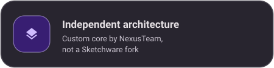
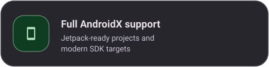
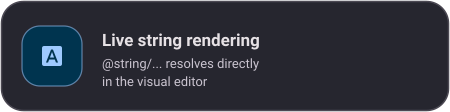
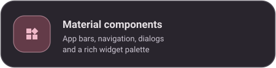
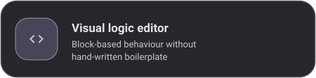
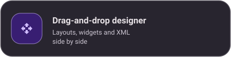
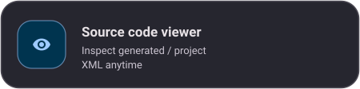
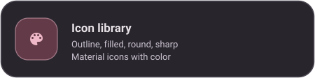

<div align="center">


<br/>

<a href="#-installation"></a>
<a href="#-key-features"></a>
<a href="#-interface-preview"></a>
<a href="#-contributing"></a>

</div>

<br/>


**BlackLogics** is not a fork. It is an independent IDE architecture by **NexusTeam (Smart India Gaming)**. It bridges drag-and-drop simplicity with the full Android SDK: design UI visually, wire logic with blocks, protect release builds with ProGuard / AiJiaMi Dex encryption / resource encryption, then export or run.

<div align="center">

</div>

<br/>


<table>
<tr><td></td><td></td></tr>
<tr><td></td><td></td></tr>
<tr><td></td><td></td></tr>
<tr><td></td><td></td></tr>
</table>

<br/>


<table>
<tr><td></td><td></td></tr>
<tr><td></td><td></td></tr>
<tr><td></td><td></td></tr>
</table>

<br/>

### 🛡️ ProGuard Manager

Turn on protection so classes and methods are renamed at build time: smaller APK, harder to reverse.

- Custom keep rules (reflection, native, serialization)
- Deep library mode (recompile local libs from source)
- Optional mapping files for crash debugging

> [!WARNING]
> Test a **release** build after enabling rules. Wrong keeps can crash at runtime.

### 🔑 Dex Encryption — *AiJiaMi Enterprise*

Runtime protection against reverse engineering and code theft.

| ✅ Benefit | ⚖️ Trade-off |
| :--- | :--- |
| Blocks easy Dex decompilation | APK size can grow |
| Encrypts strings & classes | Startup may be slower |
| Anti-debug / anti-tamper | Harder to debug crashes |
| Configurable encryption | Needs correct setup |

### 🔒 Resource Encryption

Encrypt project XML, assets, and drawables into protected formats. Set and store an **encryption key** securely.

> [!IMPORTANT]
> Once enabled, resources must be **decrypted** before manual edits.

<br/>


<table>
  <tr>
    <td align="center" width="33%"><sub><b>VISUAL EDITOR</b></sub></td>
    <td align="center" width="33%"><sub><b>PROGUARD</b></sub></td>
    <td align="center" width="33%"><sub><b>DEX ENCRYPTION</b></sub></td>
  </tr>
  <tr>
    <td></td>
    <td></td>
    <td></td>
  </tr>
  <tr>
    <td align="center"><sub><b>RESOURCE ENCRYPTION</b></sub></td>
    <td align="center"><sub><b>IMPORT ICON</b></sub></td>
    <td align="center"><sub><b>SOURCE CODE</b></sub></td>
  </tr>
  <tr>
    <td></td>
    <td></td>
    <td></td>
  </tr>
</table>

<br/>


| Component | Requirement |
| :--- | :--- |
| ☕ **JDK** | Java 8+ |
| 🤖 **Android SDK** | API 21+ |
| 🐘 **Build** | Gradle |

```bash
git clone https://github.com/NexusTeamOfficial/BlackLogics-Open-Source.git
```

Open in Android Studio (or your environment), sync Gradle, then run on an API 21+ device or emulator.

<br/>


```bash
git clone https://github.com/YOUR_USERNAME/BlackLogics-Open-Source.git
git checkout -b feature/YourFeatureName
# ... changes ...
git commit -m "Add: clear description"
git push origin feature/YourFeatureName
```

Open a Pull Request with a short description of **what** changed and **why**.

<br/>


| Member | Role |
| :--- | :--- |
| **NexusTeam** | Lead architecture & UI |
| **SmartIndiaGaming** | Systems & multimedia |
| **[Gaurav](https://github.com/GauravDeveloper-Android)** | Android contributions & testing |

**License:** GPL-3.0 for `v0.0.7+` (earlier versions were MIT). See [`LICENSE`](LICENSE). Commercial / closed-source needs: see [`COMMERCIAL-LICENSE.md`](COMMERCIAL-LICENSE.md).

<br/>


<div align="center">

[](https://t.me/blacklogics)
[](https://youtube.com/@blacklogics)
[](https://github.com/NexusTeamOfficial/BlackLogics-Open-Source)

<sub>Made with passion by <b>NexusTeam</b> & <b>SmartIndiaGaming</b></sub>

</div>
