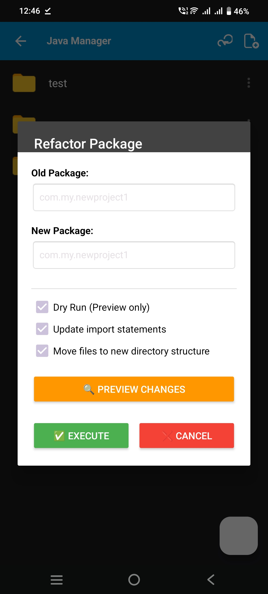
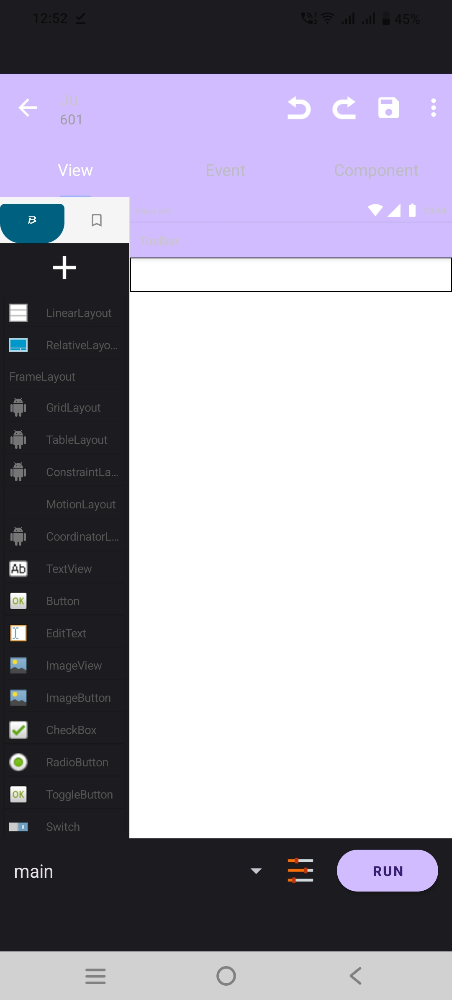
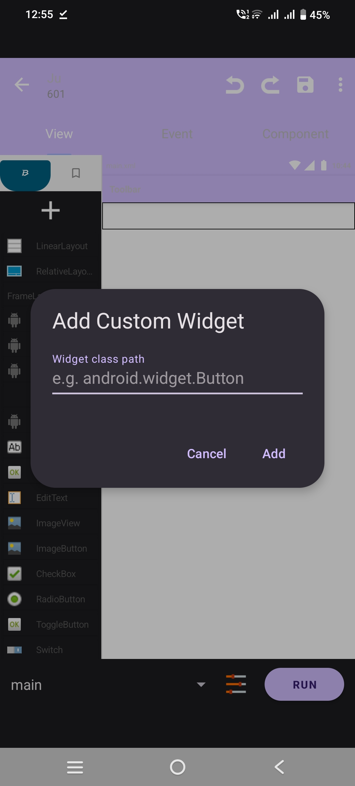

# BlackLogics

**An open-source, no-code Android IDE that runs on Android. Design screens visually, build logic with blocks, and export an APK.**


[](https://hub.xerj.org/contributors/NexusTeamOfficial)

[Releases](https://github.com/NexusTeamOfficial/BlackLogics-Open-Source/releases) · [Changelog](CHANGELOG.md) · [Telegram](https://t.me/blacklogics) · [Report a bug](https://github.com/NexusTeamOfficial/BlackLogics-Open-Source/issues)

---

## What is BlackLogics?

BlackLogics is an Android app for building Android apps. You lay out a UI with drag and drop, connect behaviour using a block-based logic editor, and the IDE generates Java source and packages it into an APK, all on your phone.

It is inspired by Sketchware-style block coding tools and is developed by **NexusTeam (SmartIndiaGaming)**.

> **Status:** early development (v0.1.x). Expect rough edges. See [Known limitations](#known-limitations).

## Features

**Design and logic**
- Drag-and-drop UI/layout editor
- Block-based logic editor with custom blocks (Blocks Manager)
- Custom attributes editor for widgets
- AndroidX and Material Components support
- Built-in source viewer for the generated Java code
- Android manifest editor
- Icon importer (Outline, Filled, Round and Sharp styles)

**Build and export**
- Export projects as APK
- Keystore creation and APK signing
- Web-to-APK (wrap a web project as an app)
- Java-to-Smali tool
- Library manager and library downloader

**Protection**
- ProGuard support
- Dex encryption
- Resource encryption

**Developer tools**
- Package refactor tool (updates imports and moves directories)
- Batch replace across files
- Real-time Logcat viewer with filtering

See the [Changelog](CHANGELOG.md) for what changed in each version.

## Screenshots

Screenshots are in the [`screenshots/`](screenshots/) folder.

| | | |
| :---: | :---: | :---: |
|  |  |  |

## Getting started

### Install the app

Download the latest APK from the [Releases](https://github.com/NexusTeamOfficial/BlackLogics-Open-Source/releases) page and install it on your device.

- Minimum Android version: **5.0 (API 21)**, as set in `app/build.gradle`
- Target SDK: 36

### Build from source

Requirements:
- Android Studio (recent version)
- JDK 17
- Android SDK Platform 34 and 36

Steps:

```bash
git clone https://github.com/NexusTeamOfficial/BlackLogics-Open-Source.git
cd BlackLogics-Open-Source
```

1. Open the cloned folder in Android Studio.
2. Let Gradle sync finish.
3. Run the `app` module on a device or emulator (API 21 or higher).

The repository does not currently include the Gradle wrapper (`gradlew`), so use Android Studio or a locally installed Gradle.

## Project structure

```
.
├── app/
│   ├── build.gradle          # applicationId com.nexusteam.blacklogics
│   ├── libs/                 # bundled libraries
│   └── src/main/
│       ├── java/com/nexusteam/blacklogics/   # activities, editors, generators
│       └── assets/                           # bundled resources and keys
├── assets/                   # README/branding images
├── screenshots/
├── CHANGELOG.md
├── CONTRIBUTORS.md
├── ATTRIBUTION.md
└── THIRD_PARTY_LICENSES.md
```

## Known limitations

Being upfront helps contributors know where help is most useful:

- **No automated tests** yet.
- **Large, hard-to-read classes.** Some files exceed 3,000 lines, and some classes have short, non-descriptive names.
- **Duplicated and nested packages** (for example `blacklogics/com/nexusteam/...`) that need cleanup.
- **Leftover `.bak` files** are still committed and should be removed.
- **Error handling** relies heavily on broad `catch (Exception)` blocks and `printStackTrace()`.
- **Release hardening:** `minifyEnabled` is off, and the manifest sets `usesCleartextTraffic` and `allowBackup` to `true`.
- **CI** (`.github/workflows/maven.yml`) is a Maven template, but the project builds with Gradle.

## Contributing

Contributions are welcome, especially for the limitations above.

1. Fork the repository.
2. Create a branch: `git checkout -b fix/short-description`
3. Make your changes and test them on a device or emulator.
4. Open a Pull Request describing **what** changed and **why**.

Please keep PRs focused, and avoid adding new `.bak` files or committing build output.

## Credits

- **SmartIndiaGaming** – creator, founder of NexusTeam
- **Gaurav Developer** – core team
- **@neplozin** – community contributor

Full list: [ATTRIBUTION.md](ATTRIBUTION.md) and [CONTRIBUTORS.md](CONTRIBUTORS.md).

BlackLogics is inspired by Sketchware, and the codebase uses some Sketchware-style naming and utilities. Third-party libraries and their licenses are listed in [THIRD_PARTY_LICENSES.md](THIRD_PARTY_LICENSES.md).

## License

The [`LICENSE`](LICENSE) file in this repository is the **GNU General Public License v3.0**.

<!--
MAINTAINERS: ATTRIBUTION.md and COMMERCIAL-LICENSE.md refer to AGPL-3.0, which
conflicts with the GPL-3.0 LICENSE file. Pick one license, make every file agree,
and update this section. Also list any upstream (e.g. Sketchware-derived) code in
THIRD_PARTY_LICENSES.md, since GPL requires it to stay under compatible terms.
-->

For commercial licensing questions, see [COMMERCIAL.md](COMMERCIAL.md).

## Community

Join the discussion on [Telegram](https://t.me/blacklogics) or open an [issue](https://github.com/NexusTeamOfficial/BlackLogics-Open-Source/issues).
